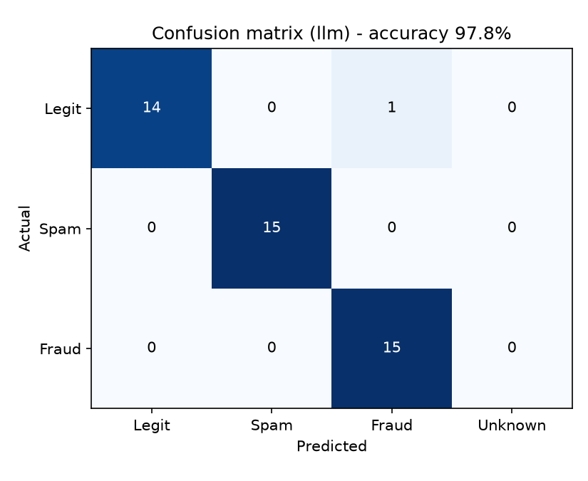

# 🚨 AI Fraud Detection System
https://ai-fraud-detection-student.streamlit.app/

A Streamlit web app that classifies messages as **Legit**, **Spam** or **Fraud**. It accepts plain text, `.eml` emails and images (read with OCR), and uses a **hybrid** approach: an LLM for accuracy, with rule-based checks as a safety net and fallback.

## Features

- **Three input types:** text, email (`.eml`), and images (Tesseract OCR)
- **Three detection modes** (switch in the sidebar):
  - *Rules only*: keyword and URL heuristics, free, works offline
  - *LLM only*: any OpenAI-compatible API (Groq, Gemini, OpenRouter, Ollama, OpenAI)
  - *Hybrid*: LLM first; rules take over if the API is down or rate-limited
- **Confidence score, reason and recommendation** for every result
- **Response caching**, so repeated messages never use API quota
- **Prompt-injection hardening:** the message is passed to the model as untrusted data
- **History** stored in SQLite, with CSV export and live analytics charts
- **Built-in evaluation** (`evaluate.py`) with accuracy, precision/recall/F1 and a confusion matrix

## Results

Evaluated on `test_data.csv`: 45 labeled messages (15 Legit, 15 Spam, 15 Fraud).

| Detector | Accuracy | Macro-F1 | Fraud caught | Genuine messages flagged as fraud |
|---|---|---|---|---|
| Rules only | 84.4% | 0.840 | 10 / 15 | 0 |
| LLM only | 97.8% | 0.978 | 15 / 15 | 1 |
| **Hybrid** | **97.8%** | **0.978** | **15 / 15** | 1 |



**Takeaways**
- Rules alone miss a third of fraud, mainly messages that need language understanding (for example, "I'm your cousin, I lost my phone, send money").
- The LLM catches all fraud in this test set.
- Hybrid matches the LLM's accuracy. Its extra value is **resilience**: if the API fails, the app keeps working at rules-only accuracy instead of crashing.

**Limitations**
- The test set is small (45 messages) and written by the author, so treat the numbers as indicative, not definitive. One extra mistake changes accuracy by about 2 points.
- Rule weights were set before testing and not tuned on the test set.
- Free LLM tiers are rate-limited and may use prompts to improve their models, so don't send private messages through the app.

## Architecture

```
Text / .eml / Image (OCR)
          │
          ▼
   extracted text ──► Detector (sidebar)
                        ├─ Rules   → signals + score
                        ├─ LLM     → cached API call (JSON reply)
                        └─ Hybrid  → LLM, rules as fallback / override
          │
          ▼
 Classification + confidence + reason + recommendation
          │
          ▼
   SQLite history · CSV export · live charts
```

| File | Purpose |
|---|---|
| `ai_fraud_detection.py` | Streamlit app (UI, login, history, charts) |
| `fraud_core.py` | Rules, cached LLM call, hybrid logic |
| `evaluate.py` | Accuracy / confusion-matrix evaluation |
| `test_data.csv` | Labeled test messages |
| `requirements.txt`, `packages.txt` | Python and system dependencies |

## Setup

**Requirements:** Python 3.10+, and [Tesseract OCR](https://github.com/UB-Mannheim/tesseract/wiki) for image input (on Windows, install to the default folder).

```bash
git clone https://github.com/itsmeenanii/ai-fraud-detection.git
cd ai-fraud-detection
python -m venv venv
venv\Scripts\activate          # Windows  (Linux/Mac: source venv/bin/activate)
pip install -r requirements.txt
```

**Configure the LLM** with environment variables (never put keys in code):

```bash
set LLM_API_KEY=your_key
set LLM_BASE_URL=https://api.groq.com/openai/v1   # omit for OpenAI
set LLM_MODEL=openai/gpt-oss-20b                  # any chat model your provider offers
```

Optional: `APP_USERNAME` and `APP_PASSWORD` change the demo login (defaults: `admin` / `1234`).

**Run**

```bash
python evaluate.py --mode all          # reproduce the results table
streamlit run ai_fraud_detection.py    # start the app
```

The app works without an API key in **Rules only** mode.

## Deployment (Streamlit Community Cloud)

1. Push this repo to GitHub (keys and databases are excluded by `.gitignore`).
2. On share.streamlit.io, create an app from the repo with main file `ai_fraud_detection.py`.
3. Add `LLM_API_KEY`, `LLM_BASE_URL`, `LLM_MODEL`, `APP_USERNAME` and `APP_PASSWORD` under **Secrets**.

Note: the SQLite history and CSV reset when the cloud app restarts.

## Tech stack

Python · Streamlit · OpenAI-compatible LLM APIs · Tesseract OCR · SQLite · Matplotlib

## Future work

- Larger, more varied labeled dataset (including real phishing samples)
- URL reputation checks and email header analysis
- Batch upload and scheduled scanning
- Persistent cloud database
## screenshot


## Author

Vempadapu Naresh Kumar · [GitHub](https://github.com/itsmeenanii)
